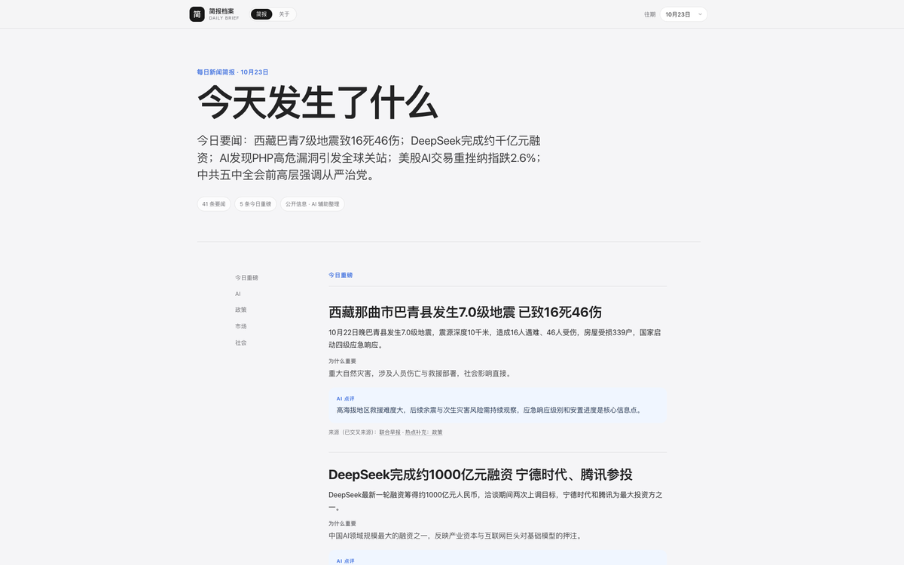

# daily-brief

Turn daily news briefs into a searchable, self-hostable static archive.



Live demo: <https://ryankiinovo.github.io/daily-brief/>

Plain Python 3 standard library — no Node, no database, no frontend framework. The output is static HTML / CSS / JS you can host anywhere.

> This repo does one thing: daily briefs. The personal reading archive (highlights, notes, stats) lives in a separate repo: [weread-brief](https://github.com/Ryankiinovo/weread-brief).

## Features

- **Daily briefs**: the homepage renders the latest issue, split into sections; a dropdown switches between past issues.
- **Content separated from presentation**: briefs are Markdown; replace `content/briefs/` and rebuild.
- **No tracking**: no third-party scripts, fonts or analytics.

## Quick start

```bash
python3 build_site.py
python3 -m http.server 8000 -d dist
```

Open <http://127.0.0.1:8000/>.

## Tests

```bash
python3 -m unittest discover -s tests -v
```

The suite copies the build script and sample content into a temp directory, rebuilds, and checks brief rendering, the single-topic page set, the about page, and that no private markers leak into the output.

Build output:

```text
dist/
  index.html          latest issue
  about.html          about page
  data/*.json         structured data per issue (archive switching)
  assets/             styles and scripts
```

## Layout

```text
build_site.py           build entry: read content, render pages, write dist/
site/                   styles and frontend scripts (copied into dist/assets/)
content/
  site.json             site name, intro, nav copy
  about.md              about page body
  briefs/               daily briefs as Markdown (YYYY-MM-DD*.md)
tests/                  build smoke tests (unittest)
```

## Writing a brief

Create `content/briefs/YYYY-MM-DD.md`:

```markdown
---
type: daily-brief
created: 2026-10-20
---

# Daily brief · 2026-10-20

> Today: one sentence covering the two or three things that matter.

## Top stories

### Headline

One or two paragraphs of facts.

Why it matters: your reasoning.

Editor note: your judgement, counterpoints, risks.

Source (example): [Example](https://example.com/news)
```

Conventions:

- The H1 becomes the page title; the blockquote becomes the lead.
- H2 splits sections; "Top stories / AI / Policy / Market / Society" are recognised, unknown headings fall into the body.
- H3 is one news item; `Why it matters:`, `Editor note:` and `Source (...):` lines get dedicated styling.
- Frontmatter can be any YAML-ish key/value pairs; it is stripped at build time.

## Make it yours

1. Edit `content/site.json` (site name, intro, signature).
2. Replace `content/briefs/` with your own briefs.
3. Optionally replace `content/about.md`.
4. Run `python3 build_site.py`.

## Deploy

`dist/` is a plain static directory: Nginx, Caddy, GitHub Pages, Cloudflare Pages all work. The repo ships `.github/workflows/pages.yml`; enable GitHub Actions as the Pages source to publish the demo.

## Data

The 26 issues in this repo are **real published briefs** (from 2026-09-15 on), curated from public sources each day: facts, why they matter, and editorial judgement. Source links point to public reports and remain the property of their authors; the site loads no third-party scripts or analytics.

To run your own archive, replace `content/briefs/` and rebuild.

## Limitations

- No search, login, comments or admin UI; content changes require a rebuild.
- The parser targets the structure above; it is not a general Markdown renderer.

## License

MIT
